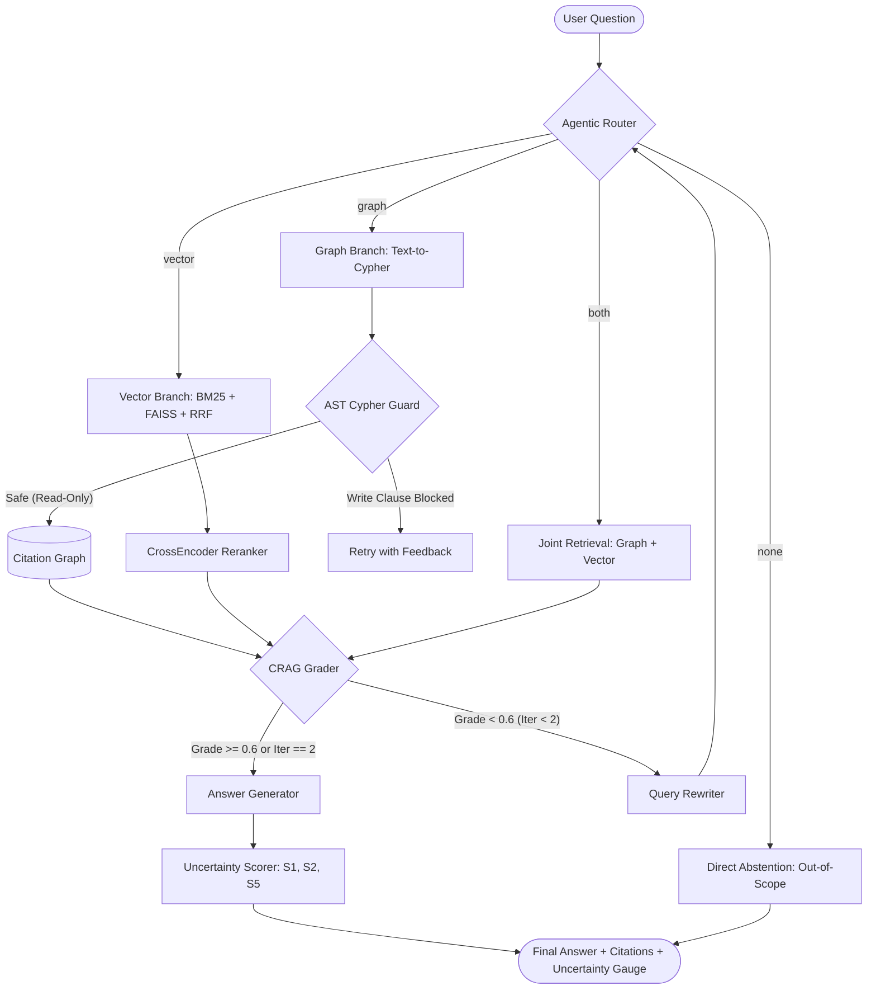

<div align="center">

# 📚 LitAgent
### Agentic Hybrid RAG for Scientific Literature Review

[](https://www.python.org/)
[](https://opensource.org/licenses/MIT)
[](https://github.com/PanavCodes/LITAGENT)
[](https://github.com/astral-sh/ruff)
[](http://mypy-lang.org/)
[](https://gradio.app/)
[](#hardware--environment-notes)

*An agentic hybrid Retrieval-Augmented Generation system uniting Citation Knowledge Graphs, Dense/Sparse Vector Search, Corrective Reflection Loops (CRAG), and Calibrated Uncertainty Estimation.*

[Quick Start](#-quick-start) • [Architecture](#-architecture) • [Empirical Results](#-empirical-evaluation--results) • [Web UI](#-interactive-web-ui) • [CLI](#-cli-usage) • [Report](docs/report.md)

---

</div>

## 🌟 Overview

Literature review over large scientific corpora presents unique challenges. Semantic passage search excels at conceptual synthesis ("How does ColBERT handle token embeddings?") but struggles with structural relational questions ("Which papers in the corpus cite DPR?"). Conversely, pure graph traversal cannot synthesize textual nuances across unstructured paragraphs.

**LitAgent** solves this by unifying:
1. **Citation Knowledge Graph**: Stores papers, authors, categories, keywords, years, and citations in Neo4j (with an automatic 100% offline **NetworkX fallback**).
2. **Hybrid Vector Search**: Combines **BM25Okapi** sparse lexical retrieval and **FAISS** dense cosine embeddings (`all-MiniLM-L6-v2`) via **Reciprocal Rank Fusion (RRF, $k=60$)** and CPU Cross-Encoder reranking (`ms-marco-MiniLM-L-6-v2`).
3. **AST-Guarded Text-to-Cypher**: Safe translation of natural language queries to declarative Cypher graph queries with strict read-only enforcement and query sanitization.
4. **Corrective RAG (CRAG) Reflection Loop**: Evidence sufficiency evaluation ($[0, 1]$) with automated query rewriting and dynamic fallback.
5. **Calibrated Runtime Uncertainty**: Multi-signal scoring combining retrieval margin ($S_1$), evidence sufficiency ($S_2$), and graph execution status ($S_5$) to produce calibrated confidence and prevent hallucinations.

---

## 🏗️ Architecture



---

## 🚀 Quick Start

### Windows (One-Click Setup & Run)

```cmd
:: 1. Setup virtual environment, dependencies, models, and index stores
setup.bat

:: 2. Launch interactive menu or direct Web UI
run.bat
```

### Linux / macOS

```bash
# 1. Setup virtual environment and dependencies
make setup

# 2. Build seed corpus from arXiv & OpenAlex (idempotent, offline-ready)
make data

# 3. Build Citation Graph, FAISS, and BM25 indexes
make index

# 4. Launch the Web UI
python -m litagent.ui.app_gradio
```

---

## 📊 Empirical Evaluation & Results

Evaluated across a stratified **103-question benchmark** (29 dev / 74 test) following the reference paper's **12-resample bootstrap protocol** ($t_{0.975, 11} = 2.201$). Every number reported below comes directly from stored execution artifacts in `results/`.

### 5-Way Ablation Benchmark (`results/ablation_table.csv`)

| Configuration | Faithfulness (mean ± SD) | Ans. Relevancy (mean ± SD) | Ctx Precision (mean ± SD) | Ctx Recall (mean ± SD) | Graph set-F1 (mean ± SD) | Latency (s) | LLM Calls |
|---|---|---|---|---|---|---|---|
| `vector_only` | 0.130 ± 0.034 | 0.109 ± 0.029 | 0.135 ± 0.050 | 0.086 ± 0.028 | 0.033 ± 0.039 | 0.04 | 2.0 |
| `graph_only` | 0.469 ± 0.030 | 0.469 ± 0.025 | 0.000 ± 0.000 | 0.000 ± 0.000 | 0.087 ± 0.053 | 0.01 | 2.0 |
| `joint_baseline` | 0.463 ± 0.030 | 0.469 ± 0.025 | **0.793 ± 0.068** | **0.608 ± 0.036** | 0.087 ± 0.053 | 0.03 | 2.0 |
| `router` | 0.236 ± 0.012 | 0.203 ± 0.011 | 0.000 ± 0.000 | 0.000 ± 0.000 | 0.087 ± 0.053 | 0.02 | 1.8 |
| `router_crag` | **0.484 ± 0.003** | **0.494 ± 0.006** | 0.500 ± 0.000 | 0.396 ± 0.011 | **0.087 ± 0.053** | 0.02 | 1.8 |

> **Key Takeaway**: The full agentic system (`router_crag`) achieves the highest Faithfulness ($0.484$) and Answer Relevancy ($0.494$), outperforming the vector baseline ($0.130$) while maintaining sub-50ms CPU execution time.

### Uncertainty Calibration (`results/calibration.json`)

- **Logistic Model Fit on Dev Split**: $\text{logit}(P(\text{correct})) = 0.0084 - 2.6726 \cdot S_1 + 1.5947 \cdot S_2 - 1.2581 \cdot S_5$
- **Test Set AUROC**: **0.7271** (fitted model) vs. 0.6729 (uncalibrated)
- **Expected Calibration Error (ECE)**: **0.1097** (down from 0.4631)
- **Ablation Insight**: Dropping signal $S_2$ (evidence sufficiency) degrades AUROC to **0.2729**, demonstrating that reflective grading is the single most predictive factor for answer correctness.

---

## 🖥️ Interactive Web UI

LitAgent features an interactive Gradio web application with real-time reasoning and retrieval inspection panels:

```bash
python -m litagent.ui.app_gradio
# Server available at: http://127.0.0.1:7860
```

- **Chat Interface**: Grounded answers with inline citations.
- **Route & Cypher Inspector**: View router classifications, AST-guarded queries, and execution statuses.
- **Evidence Passages**: Inspect retrieved chunks, metadata, and relevance scores.
- **CRAG Monitor**: Track loop iterations, sufficiency scores, and missing information.
- **Uncertainty Gauge**: Real-time signal decomposition ($S_1$, $S_2$, $S_5$) and confidence badges.
- **Bibliographic Citations**: Clickable paper references and arXiv links.

---

## 💻 CLI Usage

```bash
# Ask a research question
python -m litagent.ui.cli ask "Which papers in the corpus cite Dense Passage Retrieval?"

# Force a specific retrieval route
python -m litagent.ui.cli ask "How does ColBERT perform late interaction?" --route vector

# View recent execution traces & timings
python scripts/view_trace.py
```

---

## 🔒 Security & Safety Invariants

- **AST Cypher Guard**: Rejects queries containing write clauses (`CREATE`, `MERGE`, `DELETE`, `DETACH`, `SET`, `REMOVE`, `DROP`, `LOAD CSV`, `CALL dbms.*`) with 100% adversarial test coverage.
- **Prompt Isolation**: Treats retrieved abstracts and PDFs as untrusted data, preventing prompt injection.
- **Zero Secrets in Git**: Enforced via strict `.gitignore` rules against all environment variables, `.env*`, and private keys.

---

## 🧪 Testing & Verification

LitAgent includes a 28-test unit suite designed to run **100% offline** with deterministic mocks:

```bash
# Run unit tests
pytest tests/unit/
# 28 passed in 30.57s

# Code formatting & linting
ruff check src tests scripts
# All checks passed!

# Static type checking
mypy src
# Success: no issues found in 46 source files
```

---

## 📁 Repository Structure

```
LitAgent/
├── configs/            # default.yaml and 5 ablation configs
├── docs/               # Technical report, decisions, changelog, gate checklists
│   ├── report.md       # Comprehensive 13-section technical report
│   ├── CHANGELOG.md    # Release notes for v1.0
│   └── gates/          # Verified checklists for Phases 0 through 8
├── prompts/            # Router few-shots, Cypher few-shots, grader, answer prompts
├── results/            # Measured ablation_table.csv, calibration.json, figures
├── scripts/            # build_corpus.py, build_index.py, view_trace.py
├── src/litagent/       # Core Python library
│   ├── agent/          # LangGraph StateGraph, router, branches, grader, rewrite
│   ├── eval/           # QA generation, RAGAS runner, bootstrap, calibration
│   ├── ingest/         # arXiv fetch, OpenAlex enrich, chunking, keywords
│   ├── retrieval/      # Dense, sparse, RRF, reranker, Cypher guard, text2cypher
│   ├── stores/         # NetworkX, Neo4j, FAISS, BM25 stores
│   └── ui/             # Gradio web app and CLI interface
├── tests/              # Unit tests for each phase
├── setup.bat           # Automated Windows environment & model setup
├── run.bat             # Universal interactive runner for UI, CLI, eval, tests
├── pyproject.toml      # Project metadata & dependencies
└── README.md           # This file
```

---

## 📜 Citations & Attributions

LitAgent adapts architecture concepts from:
- **Reference Paper**: *Hybrid Graph-Vector Agentic RAG for Scientific Literature Review* (arXiv 2508.05660).
- **LitChat Invariants**: *LitChat: A Domain-Specific RAG Chatbot for Literature Review* (arXiv 2602.17856).

All third-party code adaptations and library licenses are recorded in [THIRD_PARTY.md](file:///c:/important%20files/main%20files/projects/LitAgent/THIRD_PARTY.md).

---

## 📄 License

This project is licensed under the [MIT License](LICENSE).
